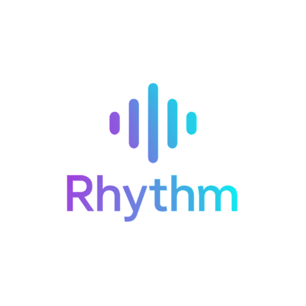
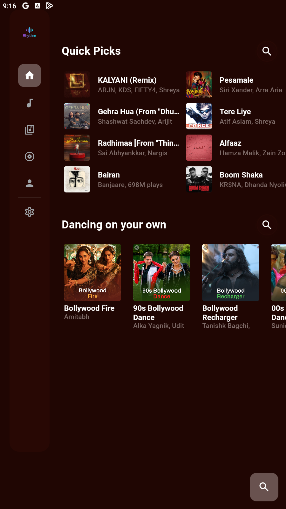
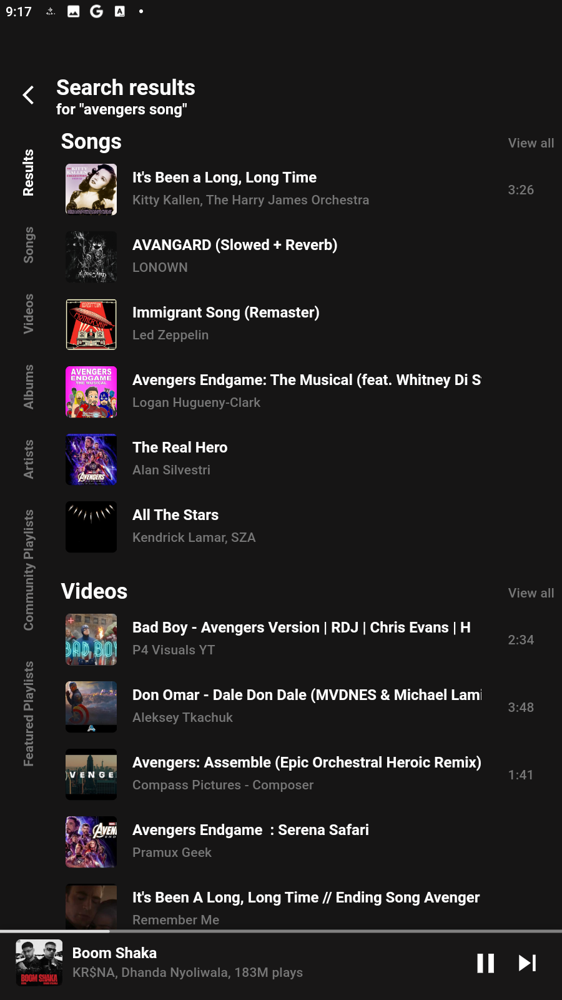
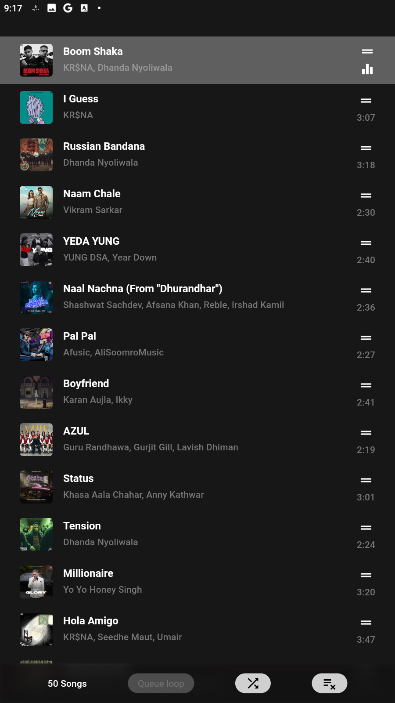
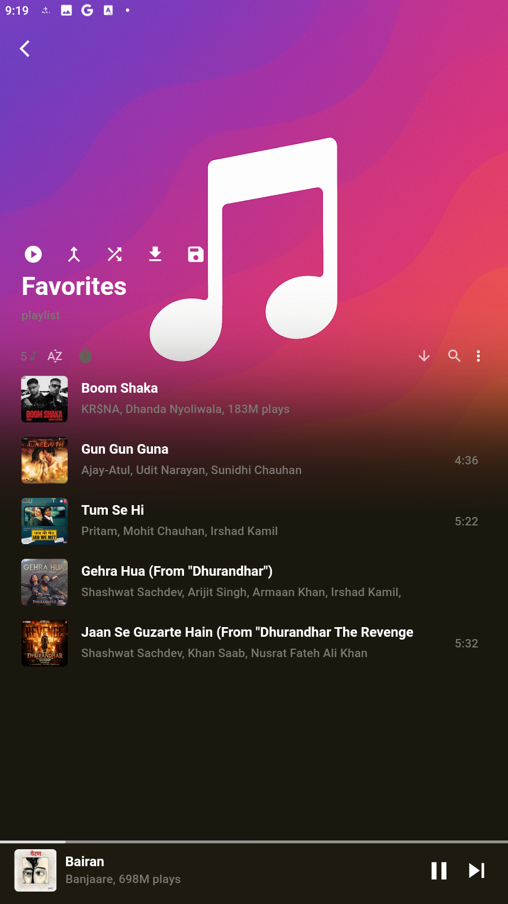
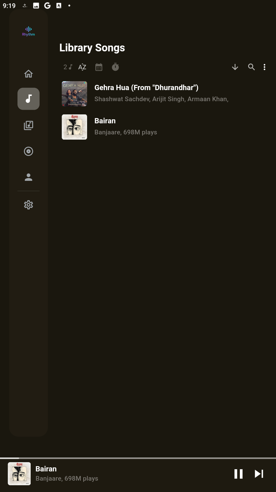
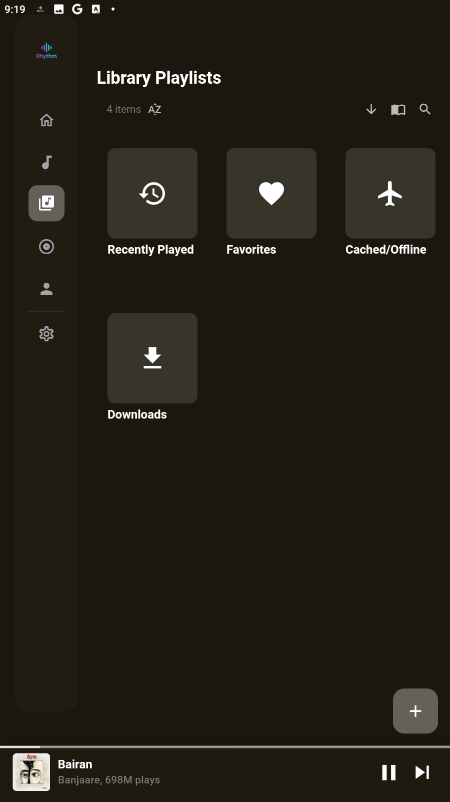
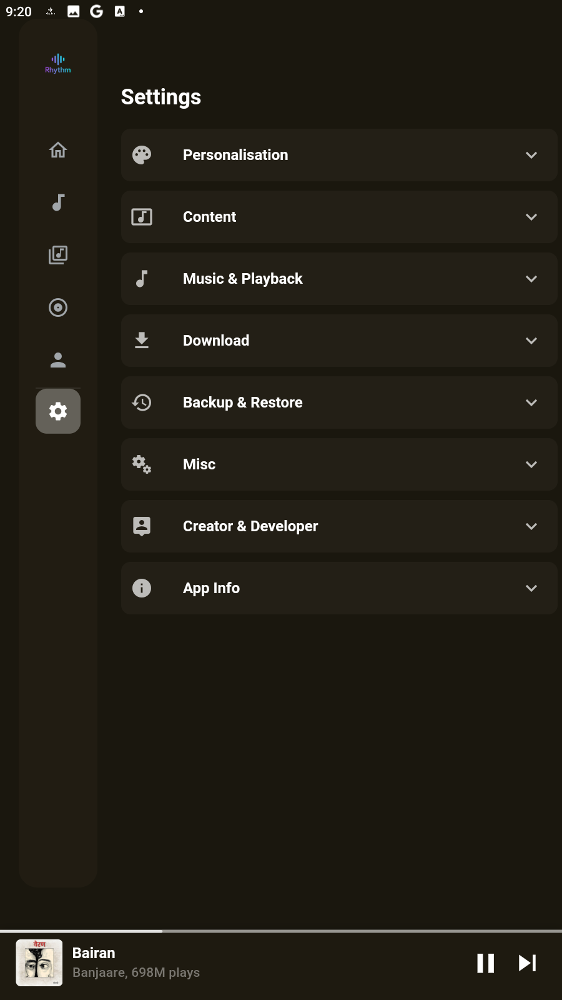
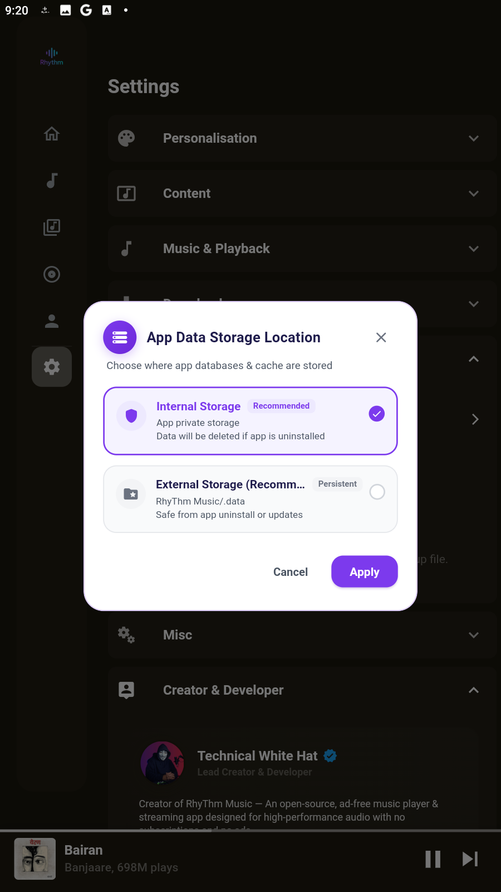
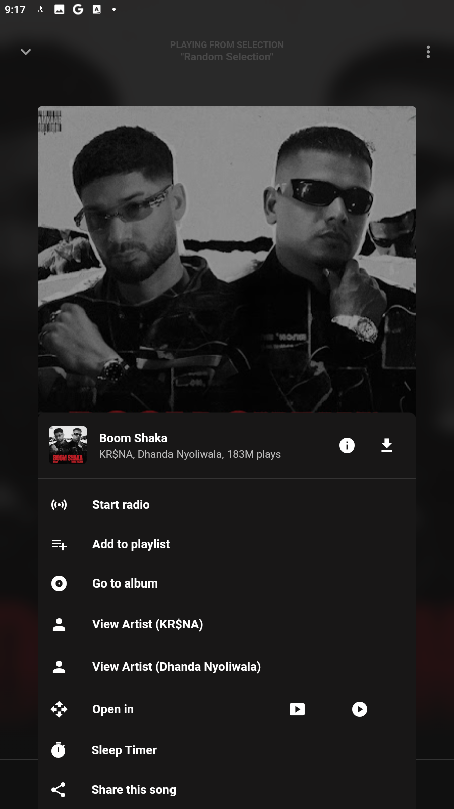

<p align="center">
  
</p>

<h1 align="center">🎵 Rhythm Music v2.1</h1>

<p align="center">
  <b>A modern, open-source, ad-free, high-fidelity music streaming and offline player crafted with passion.</b>
</p>

<p align="center">
  <a href="https://github.com/technicalwhitehat-yt/RhyThm-Music/releases/latest"></a>
  <a href="https://github.com/technicalwhitehat-yt/RhyThm-Music/releases"></a>
  <a href="https://github.com/technicalwhitehat-yt/RhyThm-Music/blob/main/LICENSE"></a>
  <a href="https://rhythm-music.free.nf/?i=2"></a>
  
  
</p>

---

## 📖 Table of Contents
- [About Rhythm Music](#-about-rhythm-music)
- [What’s New in Version 2.1](#-whats-new)

- [Screenshots & Visual Showcase](#-screenshots--visual-showcase)
- [User Features](#-user-features)
- [Download & Release Packages](#-download--release-packages)
- [Technical Architecture & Transparency (For Developers)](#-technical-architecture--transparency-for-developers)
- [Permissions & Privacy](#-permissions--privacy)
- [Building from Source](#-building-from-source)
- [Connect with Developer](#-connect-with-the-developer)
- [Developer’s Note & Dedication](#-developers-note--dedication)
- [License](#-license)

---

## 🌟 About Rhythm Music

**Rhythm Music** is a high-performance, distraction-free music streaming and offline playback application built with **Flutter**. It is designed from the ground up for true music enthusiasts who appreciate pristine sound quality, modern glassmorphic aesthetics, and total privacy without commercial advertisements or paywalls.

Whether streaming trending global hits or playing locally downloaded audio with synchronized lyrics and a custom equalizer, Rhythm Music delivers an ultra-smooth, responsive experience.

---

## 🚀 What’s New

*(This section is directly formatted for GitHub Release notes and the in-app OTA update dialog)*

### 🌟 What's New in Version 2.1.0
- 🎯 **Smart Home Feed** – Set "Based on Last Interaction" as the default discover mode, offering personalized song recommendations based on your listening habits.
- 🖥️ **Windows Desktop Playback Fix** – Full native MPV & FFmpeg streaming fix for Windows & Linux desktop with complete protocol whitelisting and direct unthrottled buffering.
- 🔄 **Cross-Platform In-App Updates** – Enhanced OTA update system with smart platform detection — automatically fetches Windows Setup (`.exe`), Linux package (`.deb`), iOS (`.ipa`), or Android (`.apk`) with one-tap installation.
- ⚡ **Zero Rate-Limiting & High-Speed Seeking** – Stream 1000+ songs/day seamlessly without seeking freezes or 403 Forbidden errors.

### 🌟 What's New in Version 2.0.0
- ⚡ **Instant Track Switching** – Tap any song while playing to instantly halt the current track and buffer the new one with zero lag or audio overlap.
- 🔄 **In-App Smart OTA Update System** – Automated background update checks with a glassmorphic dialog, real-time download progress, and one-tap APK installation.
- 💾 **Smart App Data Storage Selector** – Flexible storage management: choose between default isolated internal app storage or external device storage (`/Data` or `/.data`) with live non-destructive data migration.
- 🎨 **Modern Purple & White Glassmorphic UI** – Refreshed dialogues, smooth contrast in both Light and Dark themes, sleek purple gradients, and fluid micro-animations.
- 🔍 **Direct Search Discovery Shortcut** – Dedicated search shortcut button added to "You Might Also Like" and "Quick Picks" for instantaneous browsing.
- 👤 **Creator & Developer Hub** – Direct in-app integration of developer profile, official logo, and one-tap access to the Technical White Hat Portfolio.
- 🛠️ **Under-The-Hood Optimizations** – Upgraded Hive database handling, resolved background playback concurrency, refined media housekeeping, and improved battery efficiency.
- 🎯 **Smart Home Feed**: Set "Based on Last Interaction" as the default discover mode, offering personalized song recommendations based on your listening habits.


---

## 📸 Screenshots & Visual Showcase

Explore the aesthetics and user interface of **Rhythm Music 2.0**:

### 🏠 Home, Search & Now Playing

| 🏠 Home Screen | 🔍 Instant Search | 🎶 Now Playing Player UI |
|:---:|:---:|:---:|
|  |  |  |
| *Personalized recommendations, Quick Picks & trending music* | *Instant search with artist, album & track suggestions* | *Glassmorphic player with high-res artwork & controls* |

---

### 📑 Up Next Queue, Favorites & User Library

| 📑 Up Next Queue | ❤️ Likes & Favorites | 📚 User Library |
|:---:|:---:|:---:|
|  |  |  |
| *Dynamic queue management, drag-to-reorder & instant play* | *Quick access to all your favorite tracks with one tap* | *Organized collections of playlists, albums, artists & downloads* |

---

### 🎛️ Playlists, Settings, Storage & Player Features

| 📁 Playlists Management | ⚙️ App Settings | 💾 Storage Location Selector | 🎚️ Player Extra Features |
|:---:|:---:|:---:|:---:|
|  |  |  |  |
| *Create, edit & import custom playlists* | *Audio quality, themes & in-app updater* | *Switch between Internal & External storage* | *Equalizer, synced lyrics & sleep timer* |

---

## ✨ User Features

- 🚫 **100% Ad-Free Experience**: No banner ads, no popups, and no audio interruptions.
- 🎧 **High-Fidelity Audio Streaming**: Stream music with pristine clarity and adaptive bitrate caching.
- 📴 **Offline Mode & Smart Cache**: Download songs or play pre-cached audio without consuming internet data.
- 🎚️ **Built-in Equalizer & Audio Effects**: Customize frequency bands, bass boost, and virtualizer for your headphones.
- 📜 **Real-Time Synced Lyrics**: Follow along with karaoke-style synchronized lyrics.
- 🔄 **One-Tap In-App Updates**: Stay updated with the latest features effortlessly without visiting external websites.
- 💾 **Customizable Storage**: Keep your data in the secure app sandbox or external storage to preserve your library across app reinstalls.
- 🎨 **Aesthetic Themes**: AMOLED Pitch Black, Rich Purple Velvet, and adaptive light/dark glassmorphic accents.

---

## 📦 Download & Release Packages

<p align="center">
  <a href="https://github.com/technicalwhitehat-yt/RhyThm-Music/releases"></a>
  <a href="https://github.com/technicalwhitehat-yt/RhyThm-Music/releases/latest"></a>
</p>

Download the official **v2.1.0** release for your specific architecture and operating system:

| Platform | Package | Recommended For | Direct Download |
|:---|:---|:---|:---:|
| 🤖 **Android** | ⚡ **arm64-v8a APK**<br>`RhyThm-Music-v2.1.0-arm64-v8a-release.apk` | **Most modern 64-bit Android smartphones** (Snapdragon, MediaTek, Tensor, Exynos - Best performance, ~12 MB) | [📥 Download APK](https://github.com/technicalwhitehat-yt/RhyThm-Music/releases/download/v2.1.0/RhyThm-Music-v2.1.0-arm64-v8a-release.apk) |
| 🤖 **Android** | 🌟 **Universal APK**<br>`RhyThm-Music-v2.1.0-universal.apk` | **All Android devices** (Works on every phone, tablet, and Android TV, ~32 MB) | [📥 Download APK](https://github.com/technicalwhitehat-yt/RhyThm-Music/releases/download/v2.1.0/RhyThm-Music-v2.1.0-universal.apk) |
| 🤖 **Android** | 📱 **armeabi-v7a APK**<br>`RhyThm-Music-v2.1.0-armeabi-v7a-release.apk` | Older 32-bit Android phones (Legacy devices, ~11.7 MB) | [📥 Download APK](https://github.com/technicalwhitehat-yt/RhyThm-Music/releases/download/v2.1.0/RhyThm-Music-v2.1.0-armeabi-v7a-release.apk) |
| 🤖 **Android** | 💻 **x86_64 APK**<br>`RhyThm-Music-v2.1.0-x86_64-release.apk` | Android PC Emulators (BlueStacks, LDPlayer) & Intel/AMD Chromebooks (~12 MB) | [📥 Download APK](https://github.com/technicalwhitehat-yt/RhyThm-Music/releases/download/v2.1.0/RhyThm-Music-v2.1.0-x86_64-release.apk) |
| 🖥️ **Windows** | 🪟 **Windows Setup**<br>`RhyThm-Music-v2.1.0-windows-setup.exe` | Windows 10 & Windows 11 (64-bit installer, ~18 MB) | [📥 Download EXE](https://github.com/technicalwhitehat-yt/RhyThm-Music/releases/download/v2.1.0/RhyThm-Music-v2.1.0-windows-setup.exe) |
| 🐧 **Linux** | 📦 **Debian / Ubuntu Package**<br>`RhyThm-Music-v2.1.0-linux.deb` | Ubuntu, Debian, Linux Mint, Pop!_OS (64-bit .deb, ~10 MB) | [📥 Download DEB](https://github.com/technicalwhitehat-yt/RhyThm-Music/releases/download/v2.1.0/RhyThm-Music-v2.1.0-linux.deb) |
| 🍏 **iOS** | 📱 **iOS IPA Package**<br>`RhyThm-Music-v2.1.0.ipa` | iPhone & iPad (Sideloading via TrollStore, AltStore, Sideloadly, ~29 MB) | [📥 Download IPA](https://github.com/technicalwhitehat-yt/RhyThm-Music/releases/download/v2.1.0/RhyThm-Music-v2.1.0.ipa) |

> 💡 **Tip:** If you are unsure which Android package to choose, download **`RhyThm-Music-v2.1.0-arm64-v8a-release.apk`** for modern smartphones, or **`RhyThm-Music-v2.1.0-universal.apk`** for guaranteed compatibility with any device. All release assets can also be accessed directly on the [GitHub Releases Page](https://github.com/technicalwhitehat-yt/RhyThm-Music/releases/tag/v2.1.0).


---


## 🛠️ Technical Architecture & Transparency (For Developers)

For total transparency and open-source collaboration, here is an overview of how Rhythm Music 2.0 is built:

### 🧩 Tech Stack & Dependencies

| Component | Technology | Description |
|:---|:---|:---|
| **Framework** | [Flutter](https://flutter.dev) (v3.47+) | Cross-platform UI toolkit compiling to native ARM/x86 code |
| **Language** | [Dart](https://dart.dev) (v3.13+) | Strongly typed, null-safe asynchronous programming |
| **Audio Engine** | `just_audio` & `audio_service` | Low-latency audio playback pipeline with Android background service |
| **Local Storage** | `hive` & `hive_flutter` | Lightweight, fast key-value NoSQL database for settings and playlists |
| **State Management** | `get` (GetX) | Reactive state management, dependency injection, and micro-routing |
| **Network & API** | `dio` & `http` | HTTP client with connection pooling, retries, and streaming support |
| **Lyrics Parser** | `flutter_lyric` | LRC file parser supporting synchronized live timestamp scrolling |
| **App Updates** | Native Android Intent & `path_provider` | Download manager with FileProvider integration for APK installation |

### 📂 Architecture Overview

```
RhyThm-Music-2.0/
├── android/               # Android native configuration, permissions & FileProvider
├── assets/                # App icons, audio assets, and default placeholders
│   └── icons/             # Rhythm Music logos and developer avatar
├── img/                   # Official app screenshots and showcase assets
├── lib/
│   ├── main.dart          # App entry point, storage initialization & theme bootstrap
│   ├── services/          # Core background services:
│   │   ├── app_storage_service.dart   # Storage path resolver & live migration engine
│   │   ├── update_service.dart        # GitHub release checker & background APK downloader
│   │   ├── piped_service.dart         # Music stream & metadata resolver
│   │   └── audio_handler.dart         # Background audio session & notification controller
│   ├── ui/
│   │   ├── screens/       # Home, Search, Library, Playlists & Settings views
│   │   ├── player/        # Fullscreen player, Mini-player, Lyrics & Equalizer
│   │   └── widgets/       # Glassmorphic dialogs, update modal & storage selector
│   └── utils/             # Localization, helper functions & housekeeping utilities
└── windows/               # Windows native desktop support files
```

### 💾 Storage Architecture & Live Database Migration

Rhythm Music 2.0 introduces a dual-storage model:
1. **Internal Storage (Default)**: Uses Android's internal app sandbox directory (`/data/user/0/com.twh.rhythm_music/files`). This is completely private and secure.
2. **External Storage (Optional)**: Uses device primary storage (`/storage/emulated/0/Data` or `/.data`). When enabled, your playlists, song history, and downloaded tracks remain intact even if the application is uninstalled or refreshed.
3. **Live Migration**: When you toggle storage in Settings, the `AppStorageService` seamlessly copies all Hive database boxes, closes active memory instances, repoints `Hive.init()`, and re-opens all boxes in memory without requiring an app restart.

---

## 🔒 Permissions & Privacy

Rhythm Music respects user privacy and only requests permissions essential for core functionality:

| Permission | Purpose |
|:---|:---|
| `INTERNET` | To stream audio, fetch search queries, download lyrics, and check for OTA updates. |
| `FOREGROUND_SERVICE` | To keep the music playing smoothly in the background when the screen is locked. |
| `READ/WRITE_EXTERNAL_STORAGE` & `MANAGE_EXTERNAL_STORAGE` | Required on Android 10+ only when you choose the **External Storage** option to save/load music data to device folders. |
| `REQUEST_INSTALL_PACKAGES` | Required to trigger the Android package installer when updating the app via the In-App Updater. |
| `POST_NOTIFICATIONS` | Required on Android 13+ to display the media playback notification with controls. |

*Rhythm Music does NOT collect, sell, or track any personal user data. All history and favorites reside strictly on your device.*

---

## 💻 Building from Source

To build and compile Rhythm Music 2.0 locally:

### Prerequisites
- [Flutter SDK](https://docs.flutter.dev/get-started/install) (`v3.24.0` or higher)
- [Android Studio / Android SDK](https://developer.android.com/studio) (API 34+)
- [Git](https://git-scm.com/)

### Steps

```bash
# 1. Clone the repository
git clone https://github.com/technicalwhitehat-yt/RhyThm-Music.git
cd RhyThm-Music

# 2. Install dependencies
flutter pub get

# 3. Build Universal APK (Recommended for all devices)
flutter build apk --release

# 4. Or build ABI-Split APKs (Optimized size)
flutter build apk --release --split-per-abi

# 5. Build for Windows Desktop
flutter build windows --release
```

Compiled APKs will be located in:
`build/app/outputs/flutter-apk/`


## 🌐 Connect with the Developer

Stay updated with new releases, tutorials, and development logs:

<p align="center">
  <a href="https://rhythm-music.free.nf/?i=2"></a>
  <a href="https://www.youtube.com/@technicalwhitehat"></a>
  <a href="https://t.me/technicalwhitehat"></a>
  <a href="https://www.instagram.com/technicalwhitehat"></a>
  <a href="https://github.com/technicalwhitehat-yt"></a>
</p>

- 🌐 **Official Website / Portfolio**: [https://rhythm-music.free.nf/?i=2](https://rhythm-music.free.nf/?i=2)
- 📺 **YouTube**: [@technicalwhitehat](https://www.youtube.com/@technicalwhitehat)
- 💬 **Telegram Community**: [@technicalwhitehat](https://t.me/technicalwhitehat)
- 📸 **Instagram**: [@technicalwhitehat](https://www.instagram.com/technicalwhitehat)
- 🐙 **GitHub Organization**: [@technicalwhitehat-yt](https://github.com/technicalwhitehat-yt)

---

## 🧠 Developer’s Note & Dedication

> *“To make Rhythm Music better without changing its soul.”* 💜
>
> Rhythm Music is not just an application; it is built with heartfelt devotion and dedicated to that someone special who made this journey meaningful.
>
> If you enjoy using this application, please offer a silent prayer 🤲 for them — wish them eternal happiness 🌸 and that all their dreams come true 🌟.

**Lead Developer**: **Technical White Hat** (Afsar Ali)

---

## ⚖️ License

Distributed under the **MIT License**.  
Free to use, customize, and distribute with love and respect ❤️.

See the [LICENSE](/RhyThm-Music/LICENSE) file for complete details.

---

<p align="center">
  <b>Enjoy the rhythm. Spread the emotion. Let the music play. 🎶</b>
</p>
